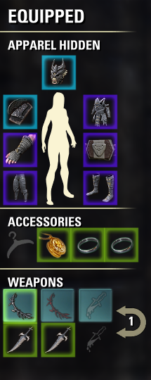

# ARC_SetGlowGuard

  

  <strong>Smart Set Tracker & Visual Glow Coordinator for The Elder Scrolls Online</strong>

---

## 🌟 Overview

**ARC_SetGlowGuard** is a lightweight, high-performance UI addon for *The Elder Scrolls Online* designed to eliminate accidental set breakage, lost items, and missing 5-piece bonuses. It automatically detects all equipped armor, weapons, and jewelry sets, assigning distinct, vibrant glow colors to each set and keeping your backpack inventory synchronized in real time.

---

## ✨ Features

- **Coordinated Set Glow**:
  All pieces belonging to the same worn set glow with a shared vibrant color (Cyan, Amber, Neon Purple, Emerald Green, Coral Crimson, Vivid Orange). Equipped Mythic items are highlighted with a distinct mythic glow.

- **Inventory Synchronization ('I')**:
  When opening your inventory with `I`, the Character equipment sheet is automatically attached on the left side of your screen. All matching set pieces in your backpack glow with the identical color and feature a colored vertical stripe on the left edge of the inventory row.

- **Incomplete Set Alert**:
  If a set bonus is incomplete (for example, `4/5` or `1/2`), a clear numerical alert is rendered on the item slot so you immediately spot unequipped or mismatched gear.

- **Multi-Language Support**:
  Full localization in **English** (default) and **Turkish** (`Türkçe`). Switch languages anytime via the settings menu.

- **Deep Customization (LibAddonMenu-2.0)**:
  - Toggle glowing highlights for equipment slots and backpack items individually.
  - Select from multiple glow texture styles (*Action Bar Glow*, *Magical Soft Highlight*, *Item Pulse*).
  - Adjust glow intensity slider.
  - Fully customizable colorpickers for every set slot, mythic items, and alert colors.

- **Slash Commands**:
  - `/sgg` or `/setglow`: Instantly refresh item glows and output active set diagnostics to chat.
  - `/sgg settings` or `/sgg menu`: Open the LibAddonMenu settings panel.

---

## 📥 Installation

### Method 1: Via Minion (Recommended)
1. Open **Minion**.
2. Select **The Elder Scrolls Online**.
3. Search for `ARC_SetGlowGuard`.
4. Click **Install**.

### Method 2: Manual Installation
1. Download the latest `ARC_SetGlowGuard.zip` release.
2. Extract the archive into your ESO AddOns directory:
   - **Windows**: `%USERPROFILE%\Documents\Elder Scrolls Online\live\AddOns\`
   - **Linux / Steam Deck (Proton)**: `~/.steam/steam/steamapps/compatdata/306130/pfx/drive_c/users/steamuser/Documents/Elder Scrolls Online/live/AddOns/`
   - **macOS**: `~/Documents/Elder Scrolls Online/live/AddOns/`
3. Ensure the folder is named `ARC_SetGlowGuard` inside `AddOns`.
4. In-game, enable the addon under `ESC -> Add-Ons` (or type `/reloadui` in chat).

---

## ⚙️ Dependencies

- **[LibAddonMenu-2.0](https://www.esoui.com/downloads/info7-LibAddonMenu.html)** (Required for the settings menu).

---

## 🙏 Acknowledgments

- Special thanks to **Baertram** (ESOUI lead moderator) for code review, event filter recommendations, and best practice guidance.

---

## 📄 License

Author: **@arcsinan** ([GitHub](https://github.com/sinanyuzgulec))  
Released under the [MIT License](https://opensource.org/licenses/MIT).
